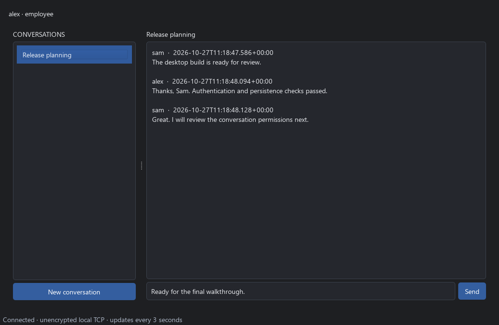
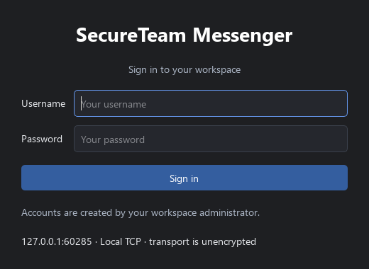
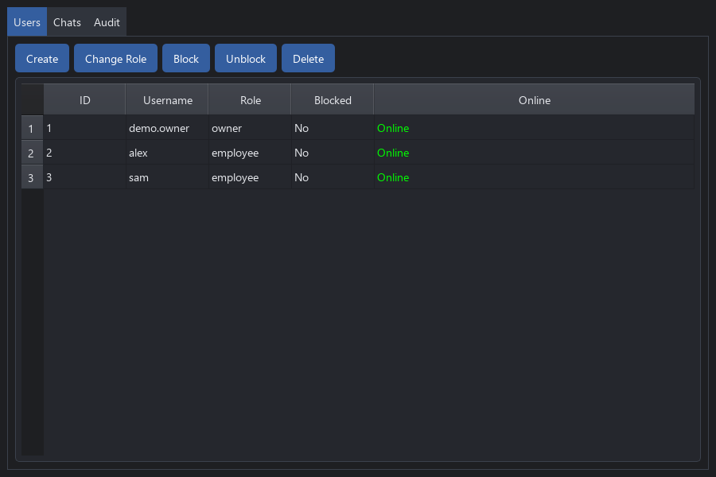
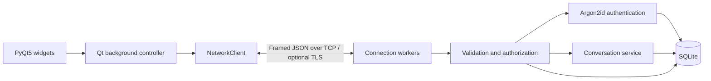

# SecureTeam Messenger

**Python Client–Server Messaging Application**

A native PyQt5 desktop messenger built to explore the engineering behind a stateful
networked application: TCP framing, authentication, server-side access controls,
concurrent clients, and durable SQLite message storage.

This educational portfolio project modernises an existing desktop application.
Its focus is understandable architecture and testable security boundaries. It is
not a service for sensitive real-world communications.

## Features

- Desktop sign-in, conversation list, message composer, and paged history.
- Multiple clients exchanging persistent messages through a threaded TCP server.
- Argon2id password hashing, connection-bound sessions, and live account checks.
- Five roles with server-enforced conversation membership and administrative scope.
- User creation, role changes, blocking, and conversation membership/archive management.
- Administrative audit records saved atomically with changes.
- Responsive Qt interfaces: blocking network work runs in a worker; results return by signals.
- Bounded length-prefixed JSON, timeouts, connection limits, and optional verified TLS.
- Real-socket integration tests, offscreen GUI tests, Ruff, and GitHub Actions.

## Screenshots

Actual PyQt5 widget captures from a running local server and synthetic users.
These were captured offscreen; they are application renders, not design mockups.



<details>
<summary>Sign-in and administration</summary>




</details>

## Architecture



The server owns identity, permissions, and persistence. Each TCP connection has its
own worker and authenticated identity. A single Qt worker serializes desktop
requests so socket responses stay paired with requests. Conversation updates are
polled every three seconds; there is no server push delivery.

See [architecture](docs/ARCHITECTURE.md) for the request lifecycle and threading model.

## Security model

Passwords use salted **Argon2id** through `argon2-cffi`. A successful legacy SHA-256
login upgrades that account's hash without removing its messages or memberships.
There are no automatically created accounts or shared default passwords.

Message history and sends require conversation membership, including for an owner.
Roles and sender identities come from the server's current database records.
Blocked accounts lose access on their next request; role changes also apply then.

| Role | Conversation actions | Administration |
| --- | --- | --- |
| Owner | Read/send as a member; create conversations | Manage lower roles, all conversation metadata/memberships, and audit |
| Organisation admin | Read/send as a member; create conversations | Manage roles below org admin, all conversation metadata/memberships, and audit |
| Department manager | Read/send as a member; create conversations | View user directory; manage conversations they own |
| Employee | Read/send as a member; create own conversations | None |
| Guest | Read/send as a member | None |

Administrators can add themselves to conversations. The server and database
operator are trusted. The database stores message text in plaintext.
**There is no end-to-end encryption or encryption at rest.**

Default loopback TCP is **unencrypted**. Remote listeners require TLS; the client
verifies the configured certificate and hostname. TLS must be enabled explicitly
at both ends. See [security and certificate setup](docs/SECURITY.md).

## Networking protocol

Each frame is a four-byte unsigned big-endian payload length followed by one
UTF-8 JSON object, limited to 1 MiB:

```json
{"type":"TEXT_MESSAGE","data":{"chat_id":1,"content":"Hello team"}}
```

Responses have type `ACK` and a `success` boolean. Errors also carry a stable
`code` and readable `error`. Partial/coalesced frames are handled explicitly;
malformed frames receive a protocol error and the connection is closed.

History returns at most 20 messages per page, in increasing message-ID order.
Large Unicode pages may contain fewer messages to respect the byte limit.
[Protocol reference](docs/PROTOCOL.md) lists operations and error behaviour.

## Database design

SQLite stores `users`, `chats`, `chat_members`, `messages`, and `audit_log`.
Usernames and memberships are unique. Foreign keys are enabled on every
connection, and chat deletion cascades to its memberships and messages.
Indexed conversation histories use message IDs for stable pagination.

Connections are short lived and owned by their calling thread. A process lock and
nested transactions keep authorization, writes, and administrative audit entries
atomic. WAL mode and a busy timeout support local concurrent clients. Existing
tables and records are preserved; startup adds query indexes in place.

## Technology stack

Python **3.11–3.13**, PyQt5 **5.15.11**, `argon2-cffi` **25.1.0**, standard-library
`socket`, `ssl`, `threading`, and `sqlite3`; pytest, pytest-qt, Ruff, and GitHub Actions.
The runtime has two direct dependencies. `cryptography` is a development-only
dependency for generating local certificates and testing TLS.

## Quick start

Install a supported Python, clone the repository, and run from its directory.

**Windows**

```bat
SETUP.bat
START_SERVER.bat --init-admin
START_SERVER.bat
```

In another terminal, run `START_CLIENT.bat`. The bootstrap command prompts for an
owner username and a password of 12–128 characters, then exits. It refuses to
replace existing accounts. `SETUP.bat` installs into `.venv`, never globally.
For two desktop clients, use `START_CLIENT.bat --new-instance` for the second.

**Manual setup / Linux**

```bash
python -m venv .venv
# Windows: .venv\Scripts\activate
source .venv/bin/activate
python -m pip install -r requirements.txt
python run_server.py --init-admin
python run_server.py
# Another activated terminal:
python run_client.py
```

On a fresh Linux desktop, Qt may need distribution packages for OpenGL/EGL and
X11 keyboard support. See the CI workflow for its headless environment setup.

Sign in as the owner. In **Administration → Users**, create two synthetic
employee accounts. In **Chats**, create a conversation and select both users.
Sign in from two clients, select the conversation, and send messages. Restarting
the server retains the conversation and its messages. After a disconnect, use
**Reconnect / sign in**; reconnecting requires credentials again.

`python run_server.py --help` and `python run_client.py --help` list connection,
TLS, and database options. The default database is `corporate_messenger.db` beside
the entry points; `--database PATH` selects a different file. The default listener
is `127.0.0.1:5555`. A second server cannot bind that same address and port.

### Existing databases

Stop the old server and make a backup before opening an existing database with
the new version. The existing user database in a local checkout is not committed,
reset, or used by tests. Legacy hashes upgrade only after a valid login.
If you previously used a default password, replace it locally before using the app:

```bash
python run_server.py --reset-password YOUR_USERNAME
```

Stop the server for this local recovery operation. It prompts for the new
password and preserves account IDs, messages, memberships, and roles. Copying a
live SQLite file is not a safe backup procedure; use SQLite's backup API, or stop
all processes and copy the database together with any `-wal`/`-shm` sidecars.
Do not publish those files.

## Testing and development

```bash
python -m pip install -r requirements-dev.txt
python -m pip check
python -m ruff check .
python -m ruff format --check .
python -m pytest -q
python -m pip_audit --strict -r requirements.txt
python -m scripts.benchmark
python -m scripts.capture_screenshots
```

GUI tests default to Qt's offscreen platform. All tests and helper demos use
temporary databases and OS-assigned local ports. They never use your account
database. A firewall/sandbox must allow localhost sockets. The screenshot helper
recreates the three documented images from actual running widgets.

GitHub Actions runs lint, format, and tests on Windows/Linux with Python 3.11,
3.12, and 3.13, plus a runtime dependency audit. See
[verification results](docs/VERIFICATION.md) for measured results and boundaries.
Direct runtime dependencies are pinned; transitive Qt wheels vary by platform.
Use `python -m pip freeze` to record a particular resolved local environment.

## Project structure

```text
run_client.py / run_server.py       CLI entry points and account bootstrap
client/controller.py               Qt worker orchestration
client/network.py                  Sequential framed TCP client
client/gui/                        Sign-in, messenger, administration
server/server.py                   Socket lifecycle, limits, sessions, TLS
server/router.py                   Validation, RBAC, atomic administration
server/auth.py                     Argon2id and legacy hash migration
server/message_handler.py          Membership-protected history and sends
server/database.py                 SQLite schema, queries, transactions
shared/                            Protocol, roles, validation, limits, TLS
scripts/                           Certificate, benchmark, screenshot utilities
tests/                             Unit, real TCP/TLS, database and GUI tests
docs/                              Architecture, security, protocol, evidence
```

## Known limitations and portfolio context

This is an educational engineering project, not an independently assessed secure
communications product. It has no MFA, public self-registration, end-to-end
encryption, attachment transfer, automatic backups, push notifications, or
exactly-once sends after an interrupted connection. A failed send may already
have been saved; inspect history before retrying.

Sessions last one hour and are not resumed across connections. List endpoints
show at most 1,000 records and indicate truncation; the desktop is intended for
small datasets. Managers have ownership scope, not a model of organisational
departments. Deleting accounts referenced by history, owned conversations, or
audit records is prevented; block them instead. The server supports IPv4.

The supported Python/OS matrix is configured in CI; local validation was on
Windows/Python 3.12. Offscreen GUI tests do not replace hands-on desktop testing
of DPI scaling, platform window decorations, or assistive technologies.
Upstream Qt native-library advisories require separate review; a clean Python
package audit is not a comprehensive assessment of bundled native libraries.

The project demonstrates improvements to an existing codebase: consolidating
unused implementations, preserving data compatibility, enforcing trust boundaries,
and verifying real network behaviour. See [initial findings](docs/AUDIT.md) and
[the release report](docs/RELEASE_REPORT.md) for the scope and evidence.
