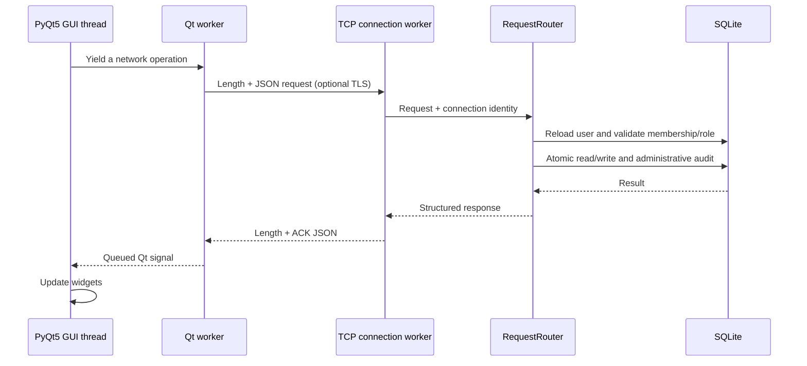

# Architecture

## Modules and boundaries

`run_client.py` and `run_server.py` are CLI entry points. The first creates the Qt
application and optional verified TLS context; the second handles explicit
bootstrap/recovery and server lifecycle. `python -m client.client` delegates to
the same desktop entry point rather than maintaining another application flow.

- `client/gui/` owns widgets, validation feedback, role-appropriate controls,
  polling, and presentation. It never decides authoritative access.
- `client/controller.py` runs yielded callables in a single-worker `QThreadPool`.
  Its `background` decorator resumes widget generators through Qt result signals
  on the GUI thread. Repeated operations are coalesced and the backlog is capped
  at 16 jobs. Closed widgets drop completions; main-window closure closes sockets.
- `client/network.py` owns a synchronous request/response API, framing, timeouts,
  transport state, and a request lock. A connection generation prevents a cancelled
  connect from restoring a socket after the user closes the dialog. The same API
  is usable by integration tests without Qt widgets.
- `shared/` defines protocol names, byte framing, limits, role hierarchy, input
  validation, and standard-library TLS context setup. It imports no GUI/server code.
- `server/server.py` owns socket acceptance, TLS handshakes, bounded worker
  lifecycle, connection-bound identities, expiry, and transport rate limits.
- `server/router.py` dispatches requests, checks current accounts/capabilities,
  validates fields, and groups administration and audit writes in transactions.
- `server/auth.py` verifies Argon2id/legacy hashes, upgrades hashes, and bounds
  login attempts/hash work. It does not duplicate socket session management.
- `server/message_handler.py` requires membership for message/history operations,
  enforces archives, and constructs bounded history pages.
- `server/database.py` owns the existing SQLite schema and parameterized queries.

## Threading and resources

The listener accepts at most 32 connections, counting unauthenticated sockets and
pending TLS handshakes. Each connection worker processes one request at a time.
A lock protects connection/user/worker registries, and sockets are closed on all
exit paths. Shutdown closes the listener and all connections, then joins workers.
The CLI handles Ctrl+C. Read, write, handshake, and session deadlines bound work.

Qt widgets are created and updated on the application thread. A single client
worker keeps request/response order across the messenger and administration
screens. It does not emit unsolicited messages or attempt background re-login.
Closing a window stops its timers; application shutdown interrupts sockets and
waits for the pool. A failed send is not retried because its commit status may be
unknown after a network failure.

SQLite connections are created on the calling thread, reused only within a nested
transaction on that thread, and explicitly closed. No `check_same_thread=False`
connection is shared. An `RLock` serializes database work in this server process;
`BEGIN IMMEDIATE` protects a request's permission checks and mutations from other
writers. WAL, foreign keys, and a five-second busy timeout are enabled. Nested
repository calls share the outer transaction; errors roll back the entire action.
This favours correctness and simplicity for a small local workload over maximum
write throughput. An external writer may still cause a bounded storage error.

## Persistence and compatibility

The schema retains `users`, `chats`, `chat_members`, `messages`, and `audit_log`.
Startup adds `(chat_id, id)` and `(user_id, chat_id)` indexes without replacing
legacy tables. Password hashes are upgraded in place after valid authentication.
The previous runtime stored plaintext messages; the disconnected encryption code
never encrypted that live path. Removing it does not convert or destroy messages.

Chat creation and membership selection are atomic. An owner remains a member
when membership is edited. Foreign keys cascade chat deletion to dependent rows;
user deletion is refused when history/ownership/audit references would be broken.
Audit entries share the actor's administrative mutation transaction.

## Delivery, order, and history

The server acknowledges sends after SQLite commits. Increasing SQLite message IDs
provide a total persistence order; timestamps are UTC display metadata, not an
ordering clock. GUI polling fetches updates every three seconds. History uses a
strict `before_id` cursor and up to 20 messages per page (fewer for large encoded
messages), returned in increasing ID order. Refresh fills short bursts across
pages; very large bursts reset the view to the newest page with earlier history
available through the paging button. There are no read receipts, delivery receipts,
server push, or exactly-once replay IDs.

## Errors

The transport closes malformed/slow connections without stopping the listener.
The router maps validation, access, integrity, storage, and unexpected failures to
structured ACK errors. Unexpected failures are logged diagnostically, while
normal clients see a readable message. The GUI preserves an unsent draft on error,
labels a disconnect, disables sending, and offers explicit reauthentication.

Unused alternate token authentication, custom AES-CBC/file handling, copy-based
backup code, incomplete cache/model classes, and an empty chat widget were removed.
The application retains the original TCP/SQLite/PyQt5 foundation and administration
flows, with one authoritative implementation of each concern.
